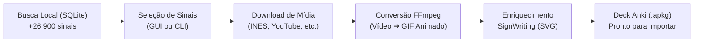

# Libras Anki Generator

Gerador de decks do [Anki](https://apps.ankiweb.net/) para estudo de **Libras** (Língua Brasileira de Sinais). Busca sinais em bases integradas e dicionários online, converte vídeos para **GIFs animados**, adiciona enriquecimento automático com escrita em **SignWriting (SWU)** e empacota tudo em arquivos `.apkg` prontos para importação.

Inclui uma **interface gráfica desktop completa (Libras Anki Studio)** em PyQt6 e uma **linha de comando (CLI)** rápida e voltada para automações.

> Licença: **GPLv3 or later** — ver [LICENSE](LICENSE).

---

## Principais Recursos

- 🖥️ **Libras Anki Studio (GUI Desktop)**: Interface moderna em PyQt6 (tema escuro) com busca offline-first, player de vídeo embutido (MP4 e YouTube via WebEngine sem download prévio), visualizador de SignWriting em SVG e construtor interativo de decks.
- 📦 **Base local unificada com +26.900 sinais**: Dicionários consolidados localmente (`data/libras.db`) para buscas instantâneas sem depender de conexões instáveis.
- ✍️ **SignWriting (SWU) integrado**: Mais de **39.700 termos** mapeados para escrita em SignWriting (`data/signpuddle.db`), renderizados em SVG vetorial de alta nitidez diretamente nos cards do Anki.
- 🎞️ **GIF animado universal**: Conversão automática com FFmpeg. O formato GIF funciona nativamente em qualquer cliente Anki (Desktop, AnkiDroid, AnkiMobile/iOS) sem travamentos ou incompatibilidades de codec.
- 🔄 **Agrupamento inteligente de variantes**: Palavras com múltiplos sinais (ex.: `PRETO1` e `PRETO2` do INES) são agrupadas no mesmo card com GIFs lado a lado e rótulos de identificação.
- ⚡ **Cache automático de mídias**: Vídeos e GIFs processados são preservados em cache local (`output/media/` e `output/media_converted/`), agilizando recriações de decks.

---

## Como Funciona



1. **Busca e Seleção** — Consulta rápida no banco SQLite local (`data/libras.db`) filtrando por palavras, glosas, categorias ou tags.
2. **Download sob demanda** — Baixa os vídeos das fontes para `output/media/`.
3. **Conversão para GIF** — Processa cada vídeo em GIF animado via FFmpeg em `output/media_converted/` (com cache automático).
4. **Enriquecimento com SignWriting** — Consulta o termo em `data/signpuddle.db` e anexa o diagrama vetorial em SVG.
5. **Geração do Deck** — Agrupa variantes por palavra-base, gera IDs determinísticos e empacota o arquivo `.apkg`.

---

## Requisitos

- **Python** >= 3.8
- **[FFmpeg](https://ffmpeg.org/)** instalado no sistema e acessível no `PATH`
- **VPN** (opcional, mas recomendada para downloads estáveis do YouTube/RedeSurdos sem bloqueios de taxa)

---

## Instalação e Inicialização Rápida

### Opção 1: Via script facilitador (`run_script.sh`)

O script `run_script.sh` detecta ou cria o ambiente virtual (usando `uv` ou `python3 -m venv`), instala dependências, inicializa o banco SQLite se ausente e executa o aplicativo:

```bash
chmod +x run_script.sh

# Inicia a Interface Gráfica (Desktop)
./run_script.sh

# Ou executa comandos da CLI
./run_script.sh --help
./run_script.sh --words "amarelo, azul, verde" --deck-name "Cores"
```

### Opção 2: Instalação Manual

```bash
python3 -m venv venv-rede-surdos
source venv-rede-surdos/bin/activate
pip install -e ".[test]"
```

Antes do primeiro uso (ou após atualizar o repositório), inicialize o banco de dados SQLite local:

```bash
libras-anki --init-db
```

---

## Interface Gráfica — Libras Anki Studio

Abra o aplicativo desktop com qualquer um dos comandos:

```bash
./run_script.sh
# ou
libras-anki-gui
# ou
libras-anki --gui
```

### Funcionalidades da GUI:
- **Painel Esquerdo (Busca)**: Busca instantânea local por palavras, glosas e tags em mais de 26 mil sinais.
- **Painel Central (Preview)**:
  - Reprodutor de vídeo integrado (MP4 direto via `QMediaPlayer` ou embed do YouTube via `QWebEngineView`), sem necessidade de download prévio para visualização.
  - Visualizador vetorial de **SignWriting (SWU)** com renderização SVG.
  - Edição de títulos, exemplos e notas antes de adicionar ao deck.
- **Painel Direito (Deck)**: Lista os cards selecionados, permite reordenação, remoção e exportação assíncrona para `.apkg` com barra de progresso em tempo real.

---

## Linha de Comando (CLI)

Sem argumentos, o comando abre um menu interativo no terminal. Com argumentos, opera em **modo não-interativo** (ideal para scripts e agentes/LLMs):

```bash
# Deck de cores por lista de palavras
libras-anki \
  --words "amarelo, azul, branco, cinza, dourado, laranja, marrom, preto, rosa, roxo, verde, vermelho" \
  --sources "Ambos" \
  --deck-name "Cores - Libras" \
  --output "cores_libras.apkg"

# Deck por categoria (RedeSurdos)
libras-anki \
  --tags "Categoria::Animais" \
  --sources "RedeSurdos" \
  --deck-name "Animais - UFC" \
  --output "animais_ufc.apkg"

# Deck por assunto (INES)
libras-anki \
  --tags "Assunto::ALIMENTO" \
  --sources "INES" \
  --deck-name "Alimentos - INES" \
  --output "alimentos_ines.apkg"

# Usando arquivo externo com lista de palavras (uma por linha ou separadas por vírgula)
libras-anki \
  --words-file palavras.txt \
  --deck-name "Meu Deck" \
  --output "meu_deck.apkg"

# Consulta direta ao banco de dados SQLite
libras-anki --sql "SELECT fonte, COUNT(*) FROM sinais GROUP BY fonte"
```

### Parâmetros da CLI

| Argumento | Tipo | Descrição |
| :--- | :--- | :--- |
| `--gui` | Flag | Abre a interface gráfica desktop (PyQt6). |
| `--init-db` | Flag | Inicializa o banco SQLite, aplica migrações e importa as bases de `data/`. |
| `--force-reimport` | Flag | Força a reimportação completa das bases locais em `data/`. |
| `--import-ufc-online` | Flag | Varre a API online da Rede de Surdos UFC e importa novas postagens. |
| `--words` | Texto | Lista de palavras separadas por vírgula (busca por forma-base, ex: `preto` acha `PRETO1` e `PRETO2`). |
| `--words-file` | Caminho | Arquivo de texto/CSV com lista de palavras. |
| `--tags` | Texto | Filtro parcial de tags (ex: `Categoria::Cores`, `Gramatica::ADJETIVO`). |
| `--sources` | Texto | Fontes a incluir: `RedeSurdos`, `INES`, `UFV`, `LibrasAcademicaUFF`, `SpreadTheSign`, `CCB`, `Economia`, `FESAI`, `PIBIC`, `Ambos` (padrão: `Ambos`). |
| `--deck-name` | Texto | Nome de exibição do deck no Anki. |
| `--output` | Texto | Nome do arquivo `.apkg` gerado (salvo na pasta `output/`). |
| `--sql` | Texto | Executa query SQL direta no banco para diagnósticos ou ajustes. |

---

## Fontes de Dados Integradas

O projeto unifica dados de diversos repositórios e dicionários de referência:

| Fonte | Itens | Tipo de Mídia | Foco / Conteúdo |
| :--- | :--- | :--- | :--- |
| **INES** | ~11.500 | MP4 direto | Instituto Nacional de Educação de Surdos (vocabulário geral) |
| **RedeSurdos (UFC)** | ~5.200 | YouTube | Universidade Federal do Ceará (sinais contextualizados e categorias) |
| **SpreadTheSign** | ~4.200 | MP4 direto | Dicionário internacional de línguas de sinais |
| **LibrasAcademicaUFF** | ~2.700 | MP4 / YouTube | Universidade Federal Fluminense (termos acadêmicos) |
| **UFV** | ~2.000 | MP4 direto | Universidade Federal de Viçosa |
| **CCB** | 836 | YouTube | Glossário especializado em sinais e termos religiosos |
| **PIBIC** | 135 | YouTube | Vocabulário técnico de artes, design, animação e fotografia |
| **FESAI** | 113 | MP4 direto | Vocabulário de tecnologia da informação e computação |
| **Economia** | 40 | YouTube | Vocabulário de economia, finanças e mercado |
| **SignPuddle** | 39.760 | SVG (SWU) | Base de escrita em SignWriting para representação visual dos sinais |

---

## Estrutura do Repositório

```
libras-anki/
├── data/                  # Bases locais pré-carregadas (libras.db e signpuddle.db)
├── run_script.sh          # Script de inicialização automática (GUI e CLI)
├── src/libras_anki/
│   ├── gui/               # Interface gráfica PyQt6
│   │   ├── app.py         # Janela principal MainWindow
│   │   ├── theme.py       # Tema visual dark mode
│   │   ├── views/         # Painéis: busca (search), preview e deck
│   │   ├── widgets/       # Player de vídeo (QtMultimedia/WebEngine) e visualizador SVG
│   │   └── workers/       # Thread em background para geração de decks
│   ├── cli.py             # Interface de linha de comando
│   ├── db.py              # Camada de banco de dados SQLite, migrações e consultas
│   ├── dicionario.py      # Lógica de montagem de decks Anki, download e agrupamento
│   ├── scrapers.py        # Módulos de extração por fonte
│   ├── convert_videos.py  # Conversão de vídeo para GIF animado via FFmpeg
│   └── utils.py           # Funções auxiliares (diretórios, normalização de strings)
├── tests/                 # Suíte de testes automatizados com pytest
├── output/                # Diretório local gerado: mídias, GIFs convertidos e arquivos .apkg
├── AGENTS.md              # Guia técnico e convenções para agentes autônomos e LLMs
└── README.md              # Esta documentação
```

---

## Testes

Para executar a suíte completa de testes automatizados:

```bash
pytest tests/ -q
```

---

## Licença

Este programa é software livre: você pode redistribuí-lo e/ou modificá-lo sob os termos da **GNU General Public License v3 (ou posterior)**, publicada pela Free Software Foundation. Consulte o arquivo [LICENSE](LICENSE) para detalhes completos.
